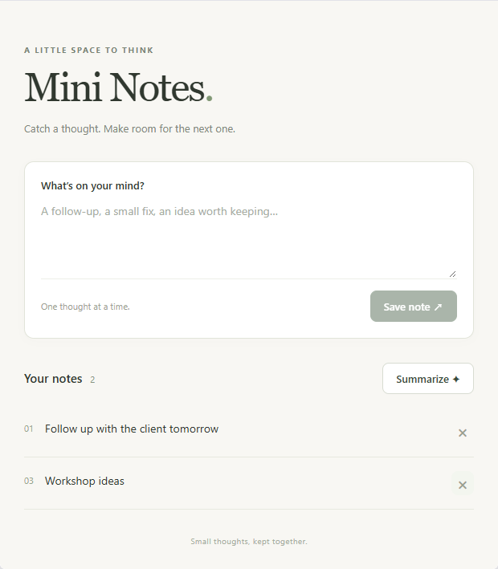
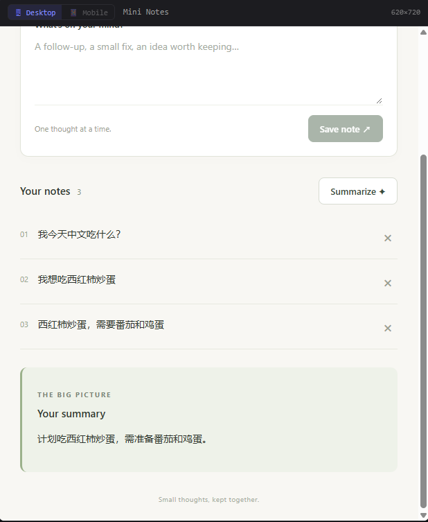
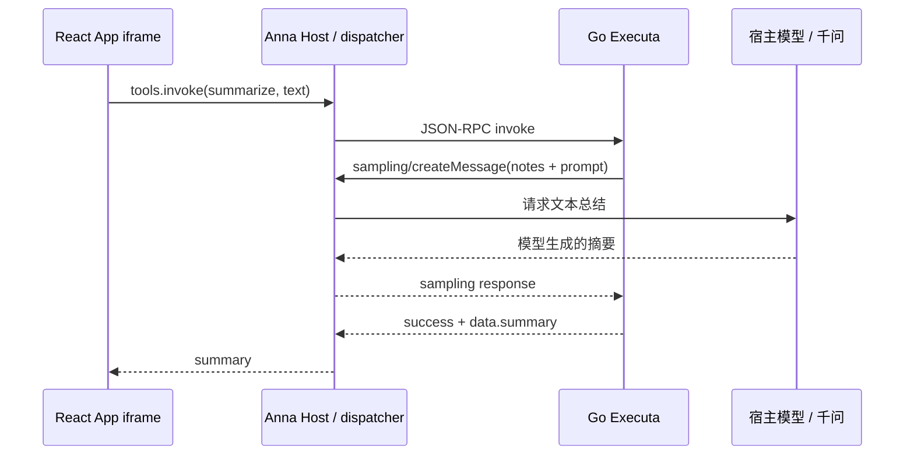
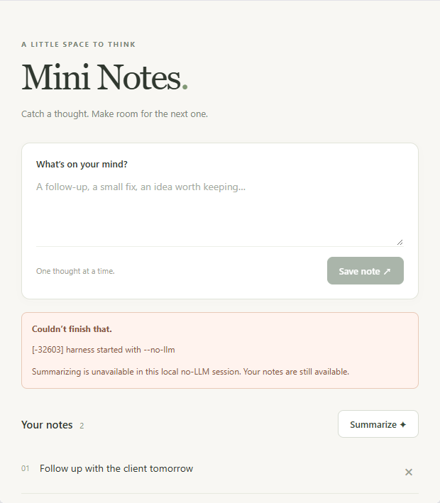
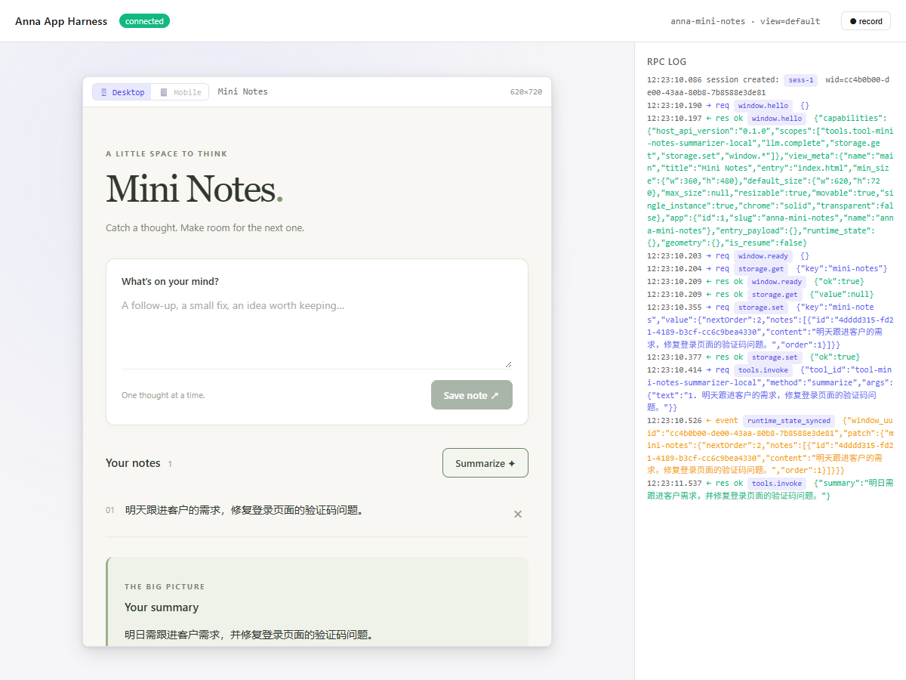

# Mini Notes with LLM Summary

Mini Notes 是本地运行的 Anna 笔记应用，用来记录待办、开发问题和临时想法，并将多条笔记总结成简短摘要。前端使用 React + TypeScript + Vite；笔记读写使用 Anna storage Host API；总结由 Go Executa 发起反向 `sampling/createMessage`，交给宿主模型完成。

项目保留原题要求的无账号验收流程，也提供千问宿主模式。本机已验证 `qwen3.8-flash` 的真实总结。无模型验收不需要 Anna 登录、LLM API key 或云端数据库；千问模式需要在本机配置百炼 API Key。

[GitHub 仓库](https://github.com/123fool/anna-mini-notes) · [三平台 Release](https://github.com/123fool/anna-mini-notes/releases/tag/v0.1.1)

## 功能介绍

| 功能 | 使用方式与行为 |
|---|---|
| 创建笔记 | 输入文字后点击 **Save note**。自动去除首尾空白，空内容不能保存；写入成功后清空输入框。 |
| 查看笔记 | 页面展示内容、添加顺序和笔记数量；连接 Anna 后自动读取已保存的笔记。 |
| 删除笔记 | 点击笔记右侧的 **×**，列表立即更新，并同步写入 Anna storage；写入失败时恢复原列表。 |
| 总结笔记 | 点击 **Summarize**，按添加顺序提交当前笔记，展示宿主模型返回的摘要；没有笔记时按钮不可用。 |
| 操作反馈 | 提供加载、空列表、处理中和错误状态；处理中禁用重复操作，笔记成功变更后清除旧摘要。 |

例如，记录“明天跟进客户需求”和“修复登录页面的验证码问题”，总结可以提炼出这两项行动。下方的实际运行截图展示了另一组笔记：午餐计划与所需食材。

**存储范围：** 本地开发使用 Anna 的 legacy 内存存储。在同一宿主 session 中重新加载 App iframe 可以读回笔记；刷新外层 dashboard 或重启宿主后不保证保留。当前功能范围是创建、查看、删除和总结，不包含编辑、搜索、标签或协作。

## 运行截图

### 创建与查看笔记



笔记显示添加顺序。图中删除了第二条，保留的顺序是 01 和 03，后续新增笔记不会复用旧编号。

### 多条笔记与千问总结



实际运行时记录了三条午餐相关笔记，点击 **Summarize** 后得到：“计划吃西红柿炒鸡蛋，需准备番茄和鸡蛋。”顶部显示名称为 **Mini Notes**。

第 5 节还提供无模型模式的预期错误截图，以及真实千问调用与 RPC 日志截图，便于对照两种运行方式。

## 快速运行

先按[安装依赖](#1-安装依赖)准备 Node.js、Go 和 uv，在项目根目录运行：

```sh
npm ci
npm run build
npm run validate
npm run dev
```

打开 [http://localhost:5180/](http://localhost:5180/)。默认模式可创建、查看和删除笔记；点击总结会得到预期的 no-LLM 错误。真实千问总结请按[千问配置说明](#可选接入千问做真实总结)填写本机 `.env`，然后改用 `npm run dev:qwen`。

| 命令 | 用途 | 模型凭据 |
|---|---|---|
| `npm run dev` | 官方 Anna harness，顶部显示 Mini Notes；默认无模型模式 | 无需 |
| `npm run dev:harness` | 直接执行原生 `anna-app dev --no-llm --storage legacy` | 无需 |
| `npm run dev:qwen` | 在同一 Anna 工具和 sampling 链路中使用千问 | 本机百炼 API Key |
| `npm run test:sampling` | 独立验证 Go 工具的 mock sampling 请求和回复 | 无需 |

## 核心链路

```text
Anna harness dashboard
  └─ App iframe → AnnaAppRuntime.connect()
       ├─ anna.storage.get / set → legacy in-memory runtime_state
       └─ anna.tools.invoke(tool-mini-notes-summarizer-local, summarize)
            └─ 本地 Go Executa → sampling/createMessage → host LLM → summary

无账号验收分两条独立路径：
  UI：anna-app dev --no-llm → 总结返回预期的 LLM-disabled 错误
  后端：anna-app executa dev --mock-sampling → 返回 fixture 总结
```

UI harness 不通过总结 fixture 伪造成功。生产工具不生成固定总结、不访问自建 HTTP 服务，也不持有模型凭据。

## 实现说明

### 前端与 Anna 连接

`src/App.tsx` 管理页面和操作状态；`src/anna.ts` 负责连接与存储；`src/summary.ts` 负责工具调用。`AnnaAppRuntime.connect()` 的 Promise 被缓存，应用建立连接后读取笔记。Vite 将源码构建为 `bundle/` 中的静态资源，由 Anna harness 在 iframe 内加载。

保存时先等待 storage 写入成功，再更新页面和清空输入框。删除使用乐观更新：先移除列表项，同时写入 storage；失败则恢复原状态并提示错误。总结只使用已经和 storage 同步的笔记。

### 笔记数据与存储

所有笔记存放在 storage key `mini-notes` 下，数据结构如下。这里的 ID 是示例，实际新增时由 `crypto.randomUUID()` 生成：

```json
{
  "nextOrder": 4,
  "notes": [
    { "id": "note-1", "content": "明天跟进客户需求", "order": 1 },
    { "id": "note-3", "content": "修复登录页面的验证码问题", "order": 3 }
  ]
}
```

`nextOrder` 持续递增，删除笔记不会重排编号。初次加载调用 `anna.storage.get`；新增和删除调用 `anna.storage.set` 写入完整状态。读取到格式错误的数据时显示错误，避免覆盖原有内容。

### 工具调用与反向 sampling

`src/summary.ts` 按添加顺序将笔记组织为文本，调用 `tool-mini-notes-summarizer-local` 的 `summarize` 方法。Go 工具只构造总结 prompt，结果必须来自宿主 sampling 回复。



Executa 通过逐行 JSON-RPC over stdio 实现 `initialize`、`describe`、`invoke`、`health` 和 `shutdown`。v2 握手声明 sampling capability；唯一的 stdin reader 同时接收普通请求与反向 RPC 回复，invoke 异步等待，因此不会阻塞后续请求。反向请求携带关联 invoke ID，等待上限 60 秒；stdout 只输出协议消息并立即 flush，日志写入 stderr。

Go 工具返回 `{ success: true, tool: "summarize", data: { summary } }`。Anna dispatcher 解包后，浏览器 SDK 得到 `{ summary }`，前端校验文本再显示。

### 千问宿主与权限

`scripts/dev.mjs` 复用官方 Anna harness，在宿主 `host.llm.complete` 处理器接入 `scripts/qwen.mjs`。适配器把 sampling 文本转换成百炼兼容接口的 messages，并将模型回复转换回 Anna sampling 格式。

密钥仅在宿主 Node 进程读取；启动 Python/Go 子进程前从环境中移除，不进入前端 bundle。App manifest 使用 schema 3，声明 storage、tools 与 sampling 所需能力，storage ACL 限定 `get/set`，tools ACL 限定本工具。额外的 `llm.complete` ACL 是当前固定 runtime 的 reverse sampling 桥所需，前端只调用 `tools.invoke`。第 5 节说明了这项兼容处理。

### 构建与发布

Go 打包程序识别本机架构，以 `CGO_ENABLED=0` 构建独立二进制。每个归档根目录包含入口 `manifest.json` 和 `bin/`。GitHub Actions 分别在 macOS ARM64、macOS x86_64 和 Windows x86_64 原生 runner 上构建、解压和运行协议测试，三个任务全部通过后统一上传到 GitHub Release。第 9、10 节提供命令和产物说明。

## 项目结构

```text
src/                      React UI、Anna 连接与 storage、tool 调用
manifest.json             Anna App schema 3、权限、UI bundle 与工具依赖
executas/summarizer/       Go Executa、v2 stdio RPC、Go 测试与归档程序
scripts/                  构建、sampling、手动协议与归档测试
fixtures/sampling.jsonl    独立后端 sampling fixture
tests/                    Playwright 真实 Anna harness 验收
.github/workflows/        App 验证及三平台 GitHub Release
docs/evidence/            本地实测截图和协议证据
bundle/                   npm run build 生成，Git 忽略
dist/                     本机二进制和 archive，Git 忽略
test-results/             重新执行测试生成的证据，Git 忽略
```

## 1. 安装依赖

需要 Node.js **22 以上**（CI 使用 24）、Go **1.27.2**、[uv](https://docs.astral.sh/uv/getting-started/installation/) 和可用的 Python。uv 可以管理 Python，Anna CLI 将通过 uvx 启动固定的 `anna-app-runtime-local@0.2.0a28`。

以下 npm 命令在项目根目录运行，Windows PowerShell 和 macOS Terminal 均适用：

```sh
git clone https://github.com/123fool/anna-mini-notes.git
cd anna-mini-notes
node --version
go version
uv --version
npm ci
```

Anna CLI 是项目依赖 **`@anna-ai/cli@0.1.58`**，可执行命令名是 `anna-app`。不需要全局安装名称相似的其他包。

为避免首次下载 Python runtime 超过 bridge 的启动等待时间，可以提前准备：

```sh
uv tool install anna-app-runtime-local==0.2.0a28
```

浏览器自动验收还需要：

```sh
npx playwright install chromium
```

## 2. 构建前端 bundle

```sh
npm run build
```

Vite 生成 `bundle/index.html` 和独立 JS/CSS 资源。`ui.bundle.entry` 与默认 view entry 均为 `index.html`，相对于 `bundle/`。

App 通过外部 ES module 使用 host 提供的 `/static/anna-apps/_sdk/latest/index.js`。这样既符合 Anna SDK 的加载约定，也避免严格 ACL 扫描把整个 SDK 内部的方法当作本 App 的调用。npm runtime 版本固定为 0.20.0。

编辑前端时，一个终端运行 `npm run build:watch`，另一个终端运行 harness；harness 会检测构建资源变化。

## 3. 严格校验 App

```sh
npm run validate
# 等价于：npx anna-app validate --strict
```

预期 `validate passed`。使用 CLI 匹配的 `@anna-ai/app-schema` 检查 manifest 和实际 bundle ACL。

工具标识统一为 `tool-mini-notes-summarizer-local`，存在于 App manifest、前端常量、本地 executa.json 和 `describe.name`。协议测试会核对这些声明的一致性。

## 4. 运行真实 UI harness

```sh
npm run dev
# 同一官方 harness，加上 Mini Notes 显示名称，仍为 no-LLM / legacy storage。
# 完全原生 CLI 验收：npm run dev:harness
# 等价于：npx anna-app dev --no-llm --storage legacy
```

打开 `http://localhost:5180/`。harness 创建 session 并将 App 加载到 iframe。测试：

1. 空输入的 Save note 不可用。
2. 添加三条笔记，内容显示、输入框清空、顺序为 01/02/03。
3. 删除第二条，列表立即变为 01/03，不重新编号。
4. 在 dashboard 右侧 RPC log 中确认 `storage.get` 和每次 `storage.set`。
5. 点击 Summarize，确认 `tools.invoke` 的工具 ID、方法和 notes 参数。

本地 legacy storage 保存在 session 的内存 `runtime_state`。不要求刷新外层 dashboard 或重启 dev 后保留；这个限制与云端 APS KV 的持久化语义不同。应用没有使用 localStorage、IndexedDB 或文件作为笔记存储。

## 5. 理解 no-LLM 下的总结结果

点击 Summarize 后的预期错误：

```text
[-32603] harness started with --no-llm
```

这证明 UI 调用了 Executa，Executa 请求 sampling，host 因禁用 LLM 拒绝了请求。它不是后端 sampling 实现失败。笔记仍可正常使用。UI 展示原始错误和简短解释。



### 当前固定 runtime 的两项集成约束

- `anna-app-runtime-local@0.2.0a28` 的 ExecutaPool 直接发送 `invoke`，未发送 `initialize`。本地 `executa.json` 使用 `scripts/dev-executa.mjs` 启动 Go 工具：先发送并检查 v2 握手，然后透传其余 JSON-RPC 消息。这个启动器不生成 summary、不拦截 sampling，也不包含在发布 archive 中。独立发布二进制必须由 host 正常初始化，协议测试直接测试该二进制。
- 本地 reverse sampling 桥使用发起调用的 App session，内部经 `llm.complete` dispatcher 校验。因此 App manifest 为这条桥声明 `permissions: llm.complete` 和 `ui.host_api.llm: [complete]`。**前端没有调用 anna.llm.complete**；浏览器测试明确断言没有 iframe 发出的 llm namespace 请求。

### 可选：接入千问做真实总结

Windows PowerShell：

```powershell
Copy-Item .env.example .env
notepad .env
npm run build
npm run dev:qwen
```

macOS：

```sh
cp .env.example .env
open -e .env
npm run build
npm run dev:qwen
```

在 `.env` 填入 `DASHSCOPE_API_KEY`，以及相同地域的 `QWEN_BASE_URL`、模型名 `QWEN_MODEL`。示例默认北京旧域名和 `qwen-plus`；也支持 `qwen3.8-flash`。可换成百炼控制台提供的业务空间专属域名，具体见 [百炼兼容接口文档](https://help.aliyun.com/zh/model-studio/compatibility-of-openai-with-dashscope)。`.env` 已被 Git 忽略；不要把密钥写入 `VITE_` 环境变量。

`scripts/dev.mjs` 复用固定 CLI 0.1.58 的官方 HarnessServer、Python dispatcher、SDK 与工具路由，仅在宿主 `host.llm.complete` 处理器接入千问。链路仍是 iframe → tools.invoke → Go Executa → sampling/createMessage → Anna dispatcher → 千问 → summary；前端和 Go 工具不接触密钥，也不直接访问模型接口。宿主请求超时 45 秒，短于工具的 60 秒等待上限；鉴权、额度、网络和空响应错误会在页面显示。默认的原题无模型验收不受影响。

此开发适配依赖 CLI 的内部模块路径，升级 CLI 时需要同步检查并运行 `npm run test:qwen`。该命令用本地模拟提供商验证真实 Anna UI/工具/sampling 成功链路和 HTTP 401 错误，不使用真实密钥，也不把模拟结果视为真实模型验证。真实千问需另外用本机密钥点击 Summarize 验证。

本机已用 `qwen3.8-flash` 验证真实总结：“明天跟进客户的需求，修复登录页面的验证码问题。”通过完整 sampling 链路返回“明日需跟进客户需求，并修复登录页面的验证码问题。”无前端 llm namespace 调用。该人工实测是辅助证据；自动验收仍使用无凭据的两个原题测试路径。



## 6. 独立测试后端 mock sampling

```sh
npm run test:sampling
```

脚本真实运行 `anna-app executa dev --mock-sampling`，将参数作为 argv 传递，避免 PowerShell/Bash 的 JSON 转义差异。预期输出包含 `PASS`，返回文本必须是：

```text
[fixture:mini-notes] Follow up with the client tomorrow and fix the login bug.
```

也可以在工具目录开启交互式 runner：

```sh
cd executas/summarizer
npx anna-app executa dev --mock-sampling ../../fixtures/sampling.jsonl --no-agent --no-image --no-upload
```

在 REPL 中输入：

```text
invoke summarize {"text":"Follow up with the client tomorrow. Fix the login bug."}
```

fixture 是 JSONL：`ns: sampling`、`method: createMessage`、`result.content.text`。其中明确的标记用于证明工具读取了 host reply，而不是返回本地拼接结果。额外禁用 agent/image/upload，避免无关的真实服务注册。

## 7. 手动检查 initialize、describe 和 invoke

从项目根目录运行：

```sh
npm run test:tool
```

该脚本构建原生 Go 二进制，并作为一个最小 host：

1. 发送 initialize，检查 `protocolVersion: 2.0` 和 `client_capabilities.sampling: {}`。
2. 发送 describe，检查裸 manifest、`parameters[]` 和 `host_capabilities: [llm.sample]`。
3. 发送 invoke，捕获反向 `sampling/createMessage`，核对 notes 和 invoke 关联信息。
4. 在等待 sampling 时发送 health，证明唯一 stdin reader 仍在工作。
5. 向反向请求 ID 发送 host response，检查 summary 原样返回；再次调用时检查 host error 传播。
6. 检查空参数、持续处理多次请求以及 EOF。Go 测试覆盖短时间超时和后续请求恢复。

查看 `test-results/protocol-transcript.jsonl` 可看到真实的工具 stdout 消息。

只检查 describe 的 PowerShell 命令：

```powershell
'{"jsonrpc":"2.0","id":1,"method":"describe"}' | & .\dist\bin\mini-notes-summarizer.exe
```

macOS：

```sh
printf '%s\n' '{"jsonrpc":"2.0","id":1,"method":"describe"}' | ./dist/bin/mini-notes-summarizer
```

实际总结请求需要保持 stdin 打开，并回应工具发出的反向请求；仅将一个 invoke JSON 管道输入后马上 EOF，无法完成 sampling。`test:tool` 提供了可直接修改的完整 host 示例。

## 8. 确认 storage 与 sampling 的实际调用证据

```sh
npm test
npm run test:harness
npm run test:qwen
```

Playwright 打开真实 dashboard/iframe，执行增删和总结，记录 `/api/session/call` 请求。不是前端 runtime mock。预期 `1 passed`。

| 生成文件 | 可验证内容 |
|---|---|
| `test-results/harness-rpc.jsonl` | `storage.get/set`、声明的 `tools.invoke`，没有前端 llm 请求 |
| `test-results/protocol-transcript.jsonl` | initialize、describe、反向请求、host reply 后的 summary |
| `test-results/sampling-stderr.txt` | `sampling/createMessage request/completed` 与关联 ID |
| `test-results/sampling-result.json` | 真实 CLI mock runner 返回的 fixture 标记 |
| `test-results/notes.png`、`no-llm.png` | 真实 harness 内的 App 截图 |

提交的 `docs/evidence/` 是本地实测样本；重新运行上述命令会产生新的 session/请求 ID，不必逐字匹配。UI 录制也可使用 dashboard 的 record/stop 按钮保存 JSONL。

## 9. 本机二进制打包与 archive 检查

```sh
npm run pack
npm run test:archive
```

打包程序使用 Go 标准库，检测本机 GOOS/GOARCH，设置 `CGO_ENABLED=0` 并构建当前机器可运行的二进制。支持 Windows x86_64、macOS ARM64 和 macOS x86_64；无需解释器运行发布工具。

```text
archive root/
├── manifest.json
└── bin/
    └── mini-notes-summarizer[.exe]
```

每个 archive 的 manifest 与二进制 describe 一致，声明显式 `runtime.binary.entrypoint`。macOS tar 中可执行文件权限为 0755；Windows 为 zip。旁边生成 `.sha256`。`test:archive` 检查 archive 成员、校验和、根 manifest 和入口，并在解压后运行实际二进制 describe。

## 10. GitHub Actions 与 Release

`Verify app` 在 main push / pull request 上执行构建、严格校验、行为测试、stdio 测试、独立 mock sampling，以及真实 UI harness。失败时上传诊断产物。

`Release native Executa binaries` 支持推送 `v*` tag 或在 Actions 页面手动 Run workflow。版本来自 package.json；当前版本为 0.1.1。

```sh
git tag v0.1.1
git push origin v0.1.1
```

三个原生 runner 分别构建并解压验证，全部成功后 publish job 一次性创建 GitHub Release，上传：

- `mini-notes-summarizer-0.1.1-darwin-arm64.tar.gz`
- `mini-notes-summarizer-0.1.1-darwin-x86_64.tar.gz`
- `mini-notes-summarizer-0.1.1-windows-x86_64.zip`
- `SHA256SUMS`

workflow artifacts 只用于 build job 到 publish job 的传递；最终交付是 [GitHub Release assets](https://github.com/123fool/anna-mini-notes/releases)。workflow 使用仓库的 GITHUB_TOKEN，不需要 Anna 凭据。已经发布的版本不覆盖；发布下一版时同步 App、Executa 和 package 版本。

## 11. 从干净 checkout 复验

```sh
npm ci
npm run check
npm run test:harness
npm run pack
npm run test:archive
```

先满足第 1 节的 Go、uv、Python 和浏览器依赖。`check` 包含前端构建、严格校验、3 个 UI 行为测试、原生协议测试和独立 sampling 测试。UI harness 和 archive 另行执行，保留它们各自的验收结果。

## 概念对应

- **App manifest**：声明 App 所需工具、权限、Host API ACL 和 UI view。
- **Bundle**：由工程化源码构建的静态页面资源，运行在 Anna iframe 中。
- **Executa**：通过逐行 JSON-RPC over stdio 提供工具方法的本地进程。
- **Anna storage / APS KV**：App 通过 Host API 使用的平台存储；本题用无登录的 legacy 内存实现验证。
- **Sampling**：工具反向请求 host 调用模型，模型和凭据由 host 管理；本地 fixture 只模拟这一步的回复。
- **Binary archive**：独立可执行文件与入口 manifest，适合 Anna binary distribution 安装。

协议和示例来源见 [THIRD_PARTY.md](THIRD_PARTY.md)。项目采用 [MIT License](LICENSE)。
